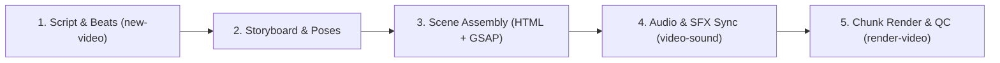

# GrowKaz Stickman Studio (`make-2d-video`)

The definitive end-to-end pipeline for creating viral, high-retention 2D stickman animated videos (YouTube Shorts, Reels, long-form explainers) in the signature GrowKaz / modern minimalist style.

---

## 1. Core Principles of GrowKaz Stickman Content

1. **Character Simplicity + Expressive Detail**:
   - High-contrast, clean 2D vector stickman (black stroke `#18181b` on light background, or pure white `#f8fafc` on dark background).
   - Expressive oversized head (`radius: 28px`), dynamic eye dots / brows, hand gestures, and clean 4px–6px jointed limbs.
   - Micro-reactions: head tilts, eye squints, sweating beads, shock lines, exclamation marks.

2. **Continuous Camera Motion**:
   - The camera **NEVER** stands completely still. It utilizes subtle constant drift (slow zoom 1.0 -> 1.08x, lateral tracking, or rotational canting) to maintain viewer eye-tracking.
   - Pacing: Visual change or gesture shift every **2.0 – 3.0 seconds**.

3. **Layered Visual Depth**:
   - **Layer 0 (Background)**: Subtle 3D room, minimal gradient, or isometric wireframe (Three.js or CSS).
   - **Layer 1 (Midground)**: Environment props (desks, computers, charts, whiteboard, money stacks, mystery boxes).
   - **Layer 2 (Character)**: Stickman actor with dynamic limb hierarchy (torso, upper arm, forearm, hand, thighs, calves).
   - **Layer 3 (Overlay / UI)**: Kinetic captions, UI badges, arrows, sound-synced emphasis rings.

---

## 2. Production Pipeline (5 Steps)



### Step 1: Voiceover & Beat Mapping
- Generate or obtain the voiceover (`voiceover.mp3`).
- Extract word-level timestamps (whisper or forced alignment).
- Split the narration into distinct 3–6 second **Scenes** (beats).

### Step 2: Storyboard & Posing
For each scene, assign:
- Primary Character Pose (e.g., `thinking`, `pointing_left`, `frantic_typing`, `confused_shrug`, `shock_fall`).
- Environment / Prop (e.g., `trading_chart`, `locked_door`, `youtube_analytics`, `mystery_folder`).
- Camera Motion (e.g., `zoom_in_face`, `pan_left_reveal`, `orbit_subtle`).

### Step 3: Compose Scene in HTML/SVG + GSAP
Use the built-in modular SVG rig template (`scripts/stickman_rig.js`):
```html
<div class="scene" id="scene-1">
  <svg viewBox="0 0 1080 1920" class="stage">
    <!-- Background layer -->
    <g class="bg-layer"></g>
    
    <!-- Stickman Character Group -->
    <g id="stickman" transform="translate(540, 1100)">
      <!-- Torso -->
      <line id="spine" x1="0" y1="-120" x2="0" y2="60" stroke="#f8fafc" stroke-width="8" stroke-linecap="round"/>
      <!-- Head -->
      <circle id="head" cx="0" cy="-160" r="38" fill="none" stroke="#f8fafc" stroke-width="8"/>
      <!-- Face expressions -->
      <circle class="eye left-eye" cx="-12" cy="-162" r="4" fill="#f8fafc"/>
      <circle class="eye right-eye" cx="12" cy="-162" r="4" fill="#f8fafc"/>
      <path id="mouth" d="M -10 -145 Q 0 -138 10 -145" stroke="#f8fafc" stroke-width="4" fill="none"/>
      
      <!-- Left Arm (Shoulder -> Elbow -> Hand) -->
      <path id="left-arm" d="M 0 -100 L -50 -50 L -90 -80" stroke="#f8fafc" stroke-width="7" fill="none" stroke-linecap="round" stroke-linejoin="round"/>
      <!-- Right Arm -->
      <path id="right-arm" d="M 0 -100 L 50 -60 L 80 -10" stroke="#f8fafc" stroke-width="7" fill="none" stroke-linecap="round" stroke-linejoin="round"/>
      
      <!-- Legs -->
      <path id="left-leg" d="M 0 60 L -40 140 L -50 240" stroke="#f8fafc" stroke-width="8" fill="none" stroke-linecap="round"/>
      <path id="right-leg" d="M 0 60 L 40 140 L 50 240" stroke="#f8fafc" stroke-width="8" fill="none" stroke-linecap="round"/>
    </g>
  </svg>
</div>
```

### Step 4: Animate with GSAP (Continuous Camera & Gestures)
```javascript
const tl = gsap.timeline();

// Camera continuous slow drift
tl.to(".stage", {
  scale: 1.06,
  x: -20,
  y: -15,
  duration: 4.5,
  ease: "sine.inOut"
}, 0);

// Character natural breathing & gesture
tl.to("#head", { y: "+=6", repeat: -1, yoyo: true, duration: 1.2, ease: "sine.inOut" }, 0);
tl.to("#right-arm", {
  attr: { d: "M 0 -100 L 60 -120 L 110 -160" }, // Pointing upward
  duration: 0.45,
  ease: "back.out(1.7)"
}, 0.8);
```

### Step 5: Render & QC via `render-video`
Execute frame capture and verify audio sync:
```bash
python scripts/render_pipeline.py --scenes ./scenes --audio voiceover.mp3 --output final_growkaz_short.mp4
```

---

## 3. Pose Reference Index

| Pose Key | Character Action | Arm Config | Emotion Indicator |
|----------|------------------|------------|-------------------|
| `idle_neutral` | Standing, subtle sway | Relaxed at sides | Calm, default eyes |
| `pointing_up` | Pointing to text/card | Right arm 45° up | Confident smile |
| `shock_drop` | Hands on head, jaw dropped | Both arms bent to ears | Wide eyes, oval mouth |
| `thinking` | Finger on chin, head tilted | Left hand on chin, right across chest | Tilted brow, looking up |
| `typing` | Fast hands alternating | Arms bent forward | Focused eyebrows |
| `running` | Forward lean, high knees | Opposition arm swings | Speed lines behind |

---

## 4. Helper Scripts in this Skill

| File | Purpose |
|------|---------|
| `scripts/stickman_rig.js` | Legacy simple 4-limb pose engine (backward compat). |
| `scripts/stickman_skeleton.js` | **Full 36-Bone Skeleton Rig v2.0** — production-ready, importable ES module. |
| `scripts/skeleton_harness.html` | **Interactive Bone Viewer** — open in browser to visualise, click, and animate all bones live. |
| `scripts/render_pipeline.py` | Automated multi-scene renderer with FFmpeg concat and LUFS normalisation. |

---

## 5. Full Skeleton Rig v2.0 (`stickman_skeleton.js`)

### Bone Hierarchy (36 Bones)

```
ROOT (pelvis)
  ├─ spine_lower → spine_mid → spine_upper → neck → head
  │                                                   ├─ eye_l / eye_r
  │                                                   ├─ eyebrow_l / eyebrow_r
  │                                                   ├─ mouth
  │                                                   └─ sweat
  ├─ shoulder_l → upperarm_l → forearm_l → hand_l
  │                                          ├─ thumb_l / index_l / pinky_l
  ├─ shoulder_r → upperarm_r → forearm_r → hand_r
  │                                          ├─ thumb_r / index_r / pinky_r
  ├─ hip_l → thigh_l → shin_l → foot_l → toe_l
  └─ hip_r → thigh_r → shin_r → foot_r → toe_r
```

### Quick Start

```javascript
import GKStickmanSkeleton from './scripts/stickman_skeleton.js';

// Create rig inside a <svg id="my-stage"> at position x=540, y=1100
const rig = new GKStickmanSkeleton('my-stage', {
  id: 'hero',           // unique ID prefix
  x: 540, y: 1100,     // world position
  scale: 1.0,
  color: '#f8fafc',     // bone stroke color
  strokeWidth: 7,
  fill: '#090e1a',      // head/hand fill
  eyeColor: '#38bdf8',
});

// ── Instant pose snap
rig.pose('idle');

// ── Smooth GSAP animated pose transition
rig.animate('phone_call', 0.5, 'power2.inOut');

// ── Animate individual bones
rig.animateBones({
  upperarm_r: { x2: 60, y2: -130 },
  forearm_r:  { x1: 60, y1: -130, x2: 90, y2: -175 }
}, 0.4, 'back.out(1.5)');

// ── Get any bone SVG element
const rightHand = rig.getBone('hand_r');
gsap.to(rightHand, { x: 30, y: -20, duration: 0.3 });

// ── Loops
rig.startBreathing();   // natural idle chest-rise
rig.startWalk(0.55);    // locomotion cycle (speed in seconds)
rig.stopWalk();         // returns to idle
```

### Named Poses

| Pose Key | Action | Key Bones Changed |
|---|---|---|
| `idle` | Natural relaxed stand | All — full body reset |
| `phone_call` | Phone held to right ear | `upperarm_r`, `forearm_r`, eyebrows, mouth |
| `pointing_up` | Right arm pointing diagonal up | `upperarm_r`, `forearm_r`, eyebrows, mouth |
| `shocked` | Both arms raised, wide stance | Both arms, both legs, face |
| `thinking` | Right hand near chin | `upperarm_r`, `forearm_r`, left arm, eyebrows |
| `crouching` | Knees bent, hunched torso | `spine_upper`, both legs |
| `peephole` | Leaning forward to door | `spine_upper`, `neck`, right arm, legs |
| `foot_inspect` | Looking down, one leg raised | `spine_upper`, left leg raised, face |
| `frozen_horror` | Rigid stiff stance | Arms stiff, legs together, horror face |
| `flinch` | Head snap left, left arm guard | `spine_upper`, left arm raised |

