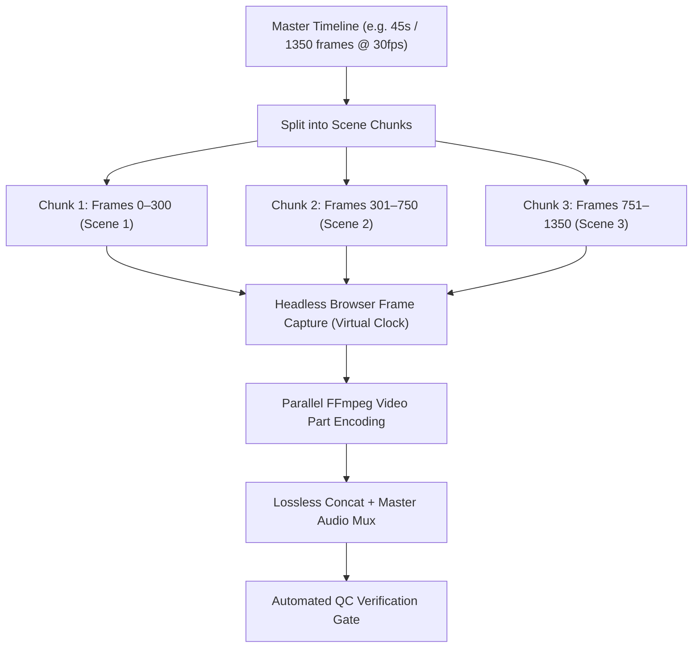

# Video Rendering & QC Engine (`render-video`)

The robust render engine for programmatic videos: split compositions into parallel chunks, eliminate rendering stalls, capture deterministic frames, and verify broadcast quality standards.

---

## 1. Chunked Rendering Architecture

Rather than rendering a 60-second video as a single monolithic browser session (which risks memory leaks and browser GPU crashes), `render-video` divides the timeline into **independent scene chunks**:



---

## 2. Rendering Commands

### Fast Preview Render (Low Res / Fast Turnaround)
```bash
python scripts/chunk_render.py --project ./ --preset preview --fps 30 --scale 0.5
```

### Production Master 1080x1920 60fps Render
```bash
python scripts/chunk_render.py --project ./ --preset production --fps 60 --width 1080 --height 1920 --crf 17
```

---

## 3. Headless Virtual Clock Capture Loop

To guarantee deterministic animation without frame drops, animations use a virtual tick counter (`window.advanceToFrame(n)`):

```javascript
// Virtual clock hooked into GSAP
window.seekVirtualFrame = function(frameNumber, fps = 30) {
  const targetTime = frameNumber / fps;
  if (window.mainTimeline) {
    window.mainTimeline.time(targetTime);
  }
};
```

---

## 4. Automated QC (Quality Control) Checks

Run the automated QC test suite before final delivery:
```bash
python scripts/qc_verifier.py --video output/final_master.mp4 --audio audio/master.mp3
```

### The 5 QC Gates:
1. **Audio-Video Length Match**: Video duration and master audio duration must match within **±0.05 seconds**.
2. **Zero Black/White Flash**: Detects any single frame drop or opacity gap at scene seams.
3. **9:16 Vertical Safe Zones**:
   - Top 15% (1080x288): Avoid key text (header/search UI).
   - Bottom 20% (1080x384): Avoid captions collision with YouTube Shorts description / audio pill.
   - Right 12% (130px): Avoid like/comment/share icon overlays.
4. **Loudness Standards**: Integrated audio must measure **-14.0 LUFS (±1.0 LUFS)** with true peak `< -1.0 dBTP`.
5. **Color Range**: Output encoded with `bt709` color primaries and `yuv420p` pixel format for universal mobile playback.

