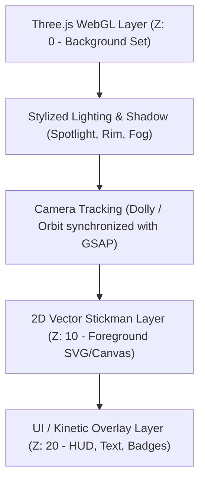

# Three.js 3D Background Sets (`threejs-scenes`)

Build lightweight, high-impact 3D sets, rooms, and volumetric backgrounds that serve as the cinematic stage for 2D stickman explainer animations.

---

## 1. Core Architecture

The GrowKaz aesthetic pairs **clean 2D vector stickman characters** with **atmospheric 3D stylized sets**. This gives videos a distinctive, high-budget hybrid look that stands out against flat 2D templates.



---

## 2. Standard Room Blueprints

### Blueprint A: The Noir / Mystery Room (Dark Office)
- **Geometry**: 3-walled room (Back wall, left wall, floor plane). A wooden desk, filing cabinets, single hanging bulb or venetian blind shadow.
- **Lighting**: Single warm spotlight (`#f59e0b`, intensity 2.5) from above, cool ambient fill (`#1e293b`, intensity 0.4), volumetric exponential fog (`#090d16`).
- **Best For**: Mystery investigations, historical facts, conspiratorial deep-dives.

### Blueprint B: The Tech / Server Vault
- **Geometry**: Grid floor, server racks with pulsing LED emissive materials, glowing circuit paths.
- **Lighting**: Cyan (`#06b6d4`) and deep violet (`#7c3aed`) directional lights, dark reflective ground (`roughness: 0.2, metalness: 0.8`).
- **Best For**: Tech, AI, cybersecurity, crypto, wealth/finance topics.

### Blueprint C: The Modern Minimalist Studio
- **Geometry**: Soft curved cyclorama wall, floating geometric podium, minimal desk.
- **Lighting**: Soft directional key light, subtle rim light, soft shadows (`PCFSoftShadowMap`).
- **Best For**: Educational explainers, productivity breakdowns, business cases.

---

## 3. Quickstart Three.js Room Script

```javascript
import * as THREE from 'three';

export function createMysteryRoom(canvasContainer) {
  const scene = new THREE.Scene();
  scene.fog = new THREE.FogExp2(0x0a0f1d, 0.04);

  const camera = new THREE.PerspectiveCamera(45, 1080 / 1920, 0.1, 100);
  camera.position.set(0, 3.5, 9);
  camera.lookAt(0, 1.2, 0);

  const renderer = new THREE.WebGLRenderer({ antialias: true, alpha: true });
  renderer.setSize(1080, 1920);
  renderer.shadowMap.enabled = true;
  renderer.shadowMap.type = THREE.PCFSoftShadowMap;
  canvasContainer.appendChild(renderer.domElement);

  // Materials
  const wallMat = new THREE.MeshStandardMaterial({ color: 0x1e293b, roughness: 0.8 });
  const floorMat = new THREE.MeshStandardMaterial({ color: 0x0f172a, roughness: 0.5 });
  const woodMat = new THREE.MeshStandardMaterial({ color: 0x334155, roughness: 0.6 });

  // Floor
  const floor = new THREE.Mesh(new THREE.PlaneGeometry(20, 20), floorMat);
  floor.rotation.x = -Math.PI / 2;
  floor.receiveShadow = true;
  scene.add(floor);

  // Back Wall
  const backWall = new THREE.Mesh(new THREE.PlaneGeometry(20, 12), wallMat);
  backWall.position.set(0, 6, -6);
  backWall.receiveShadow = true;
  scene.add(backWall);

  // Desk (Tabletop + Legs)
  const deskTop = new THREE.Mesh(new THREE.BoxGeometry(4.2, 0.18, 2.2), woodMat);
  deskTop.position.set(0, 1.5, 0);
  deskTop.castShadow = true;
  deskTop.receiveShadow = true;
  scene.add(deskTop);

  // Overhead Key Spotlight
  const spotLight = new THREE.SpotLight(0x38bdf8, 4);
  spotLight.position.set(0, 7, 2);
  spotLight.angle = Math.PI / 4;
  spotLight.penumbra = 0.5;
  spotLight.castShadow = true;
  scene.add(spotLight);

  // Ambient Dark Fill
  const ambient = new THREE.AmbientLight(0x0f172a, 1.2);
  scene.add(ambient);

  return { scene, camera, renderer };
}
```

---

## 4. GSAP Sync with Three.js Camera

Tie the Three.js camera to the GSAP timeline so that 3D camera pan/dolly runs in exact synchronization with the 2D stickman animations:

```javascript
export function animate3DCamera(camera, timeline, duration = 4.0) {
  // Push in slowly towards desk
  timeline.to(camera.position, {
    z: 7.2,
    y: 2.8,
    duration: duration,
    ease: "sine.inOut"
  }, 0);

  // Subtle pan
  timeline.to(camera.position, {
    x: 0.8,
    duration: duration,
    ease: "sine.inOut"
  }, 0);
}
```

---

## 5. Compositing 2D Stickman with 3D Set

Place the Three.js canvas as a background element with `position: absolute; z-index: 1;`.
Place the SVG stickman container as `position: absolute; z-index: 2; pointer-events: none;`.
Use matching perspective and shadow anchoring: place a subtle soft elliptical shadow SVG beneath the stickman's feet (`opacity: 0.35`) right where the 3D desk or floor meets the 2D plane.

