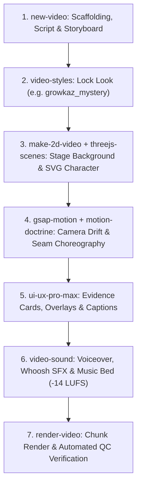

# GrowKaz Stickman Studio — Workspace Intelligence & Rules (`GEMINI.md`)

Welcome to the **GrowKaz Stickman Studio** repository. This workspace is configured with our full suite of programmatic animation pipelines, motion doctrines, 3D sets, audio engineering, and quality control systems.

---

## 1. The Core Creative Law: "Camera Kabhi Rukta Nahi"

1. **Continuous Viewport Life**:
   The camera never stands still. A continuous sub-current of motion (slow push-in, subtle lateral tracking, or organic hand-held sway) runs from the first frame to the last. Static frames kill retention.
2. **Velocity Matching at Seams (Vector Law)**:
   The exit velocity of Scene A dictates the entrance velocity of Scene B. Seams must feel like one continuous cinematic camera move, not independent slides.
3. **Character Pacing**:
   Visual changes, pose transitions, or camera focal nudges must occur every **2.0 to 2.8 seconds**.

---

## 2. Skill Registry & Execution Map

### Core Production Skills
| Skill | Command / Scope | Purpose |
|---|---|---|
| [`make-2d-video`](file:///c:/Users/iamra/OneDrive/Desktop/stick_man/.agents/skills/make-2d-video/SKILL.md) | Pipeline Orchestrator | Complete GrowKaz stickman rigging, poses, expressions, and multi-scene generation |
| [`character-animation`](file:///c:/Users/iamra/OneDrive/Desktop/stick_man/.agents/skills/character-animation/SKILL.md) | Character & Asset Mastery | FK-by-rotation rig (`rig.js`), ~35 SVG props (`props.js`), IK contact, lip-sync visemes, dance |
| [`gsap-motion`](file:///c:/Users/iamra/OneDrive/Desktop/stick_man/.agents/skills/gsap-motion/SKILL.md) | Motion & Physics | Continuous camera movement ("Camera Kabhi Rukta Nahi"), easing curves, punch-zooms |
| [`threejs-scenes`](file:///c:/Users/iamra/OneDrive/Desktop/stick_man/.agents/skills/threejs-scenes/SKILL.md) | 3D Spatial Sets | Stylized 3D background rooms (Mystery Noir, Tech Vault, Minimalist Studio) composited with 2D |
| [`procedural-backgrounds`](file:///c:/Users/iamra/OneDrive/Desktop/stick_man/.agents/skills/procedural-backgrounds/SKILL.md) | Procedural Set Engine | 100% SVG code-only backgrounds (stone walls, timber shops, boutiques, winter streets) |
| [`ui-ux-pro-max`](file:///c:/Users/iamra/OneDrive/Desktop/stick_man/.agents/skills/ui-ux-pro-max/SKILL.md) | UI & Overlays | Design intelligence for mystery evidence cards, HUD overlays, charts, color palettes, and fonts |

### Support Production Skills
| Skill | Command / Scope | Purpose |
|-------|-----------------|---------|
| [`new-video`](file:///c:/Users/iamra/OneDrive/Desktop/stick_man/.agents/skills/new-video/SKILL.md) | Scaffolding | Project kickoff, 3-second beat breakdown, script-to-storyboard generation |
| [`video-styles`](file:///c:/Users/iamra/OneDrive/Desktop/stick_man/.agents/skills/video-styles/SKILL.md) | Look Lock | Unified visual identity, locked 7px stickman stroke, 4 color profiles (`growkaz_mystery`) |
| [`video-sound`](file:///c:/Users/iamra/OneDrive/Desktop/stick_man/.agents/skills/video-sound/SKILL.md) | Audio Engineering | SFX taxonomy (whooshes, pops, impacts), -14 LUFS auto-ducking, BGM bed mixing |
| [`render-video`](file:///c:/Users/iamra/OneDrive/Desktop/stick_man/.agents/skills/render-video/SKILL.md) | Render & QC | Parallel scene chunking, virtual clock headless capture, 5-gate automated QC |

### Technical Micro-Seam & Motion Skills (HyperFrames Engine)
| Skill | Command / Scope | Purpose |
|-------|-----------------|---------|
| [`motion-doctrine`](file:///c:/Users/iamra/OneDrive/Desktop/stick_man/.agents/skills/motion-doctrine/SKILL.md) | Gateway Doctrine | High-level motion law, carrier elements, causal motion, stillness before climax |
| [`cut-the-curve`](file:///c:/Users/iamra/OneDrive/Desktop/stick_man/.agents/skills/cut-the-curve/SKILL.md) | Technique Catalog | 5 velocity-matched seams (zoom-throughs, waterfall cuts, rack-focus blur) |
| [`seam-craft`](file:///c:/Users/iamra/OneDrive/Desktop/stick_man/.agents/skills/seam-craft/SKILL.md) | Render Correctness | Zero white-flash guard, timeline compositing, seamless scene handoffs |
| [`oversized-cursor`](file:///c:/Users/iamra/OneDrive/Desktop/stick_man/.agents/skills/oversized-cursor/SKILL.md) | Eye-Carrier Cursor | ~7cqw stylized pointer, physical off-screen entry, click-ignition sequences |
| [`captions-overlay`](file:///c:/Users/iamra/OneDrive/Desktop/stick_man/.agents/skills/captions-overlay/SKILL.md) | Kinetic Typography | Word-level timing, karaoke highlights, 9:16 safe-zone compliant subtitles |

### Extended / On-Demand Skills
| Skill | Command / Scope | Purpose |
|-------|-----------------|---------|
| [`faceless-shorts`](file:///c:/Users/iamra/OneDrive/Desktop/stick_man/.agents/skills/faceless-shorts/SKILL.md) | Nafay3D Viral Pipeline | End-to-end automated vertical shorts (21 hook formulas, split-screen neon layouts) |
| [`ai-video-editor`](file:///c:/Users/iamra/OneDrive/Desktop/stick_man/.agents/skills/ai-video-editor/SKILL.md) | Nafay3D Automated Editor | Automated silence cutting, dynamic jumpcut punch-in zooms, B-roll overlays |
| [`remotion-video`](file:///c:/Users/iamra/OneDrive/Desktop/stick_man/.agents/skills/remotion-video/SKILL.md) | React Video Framework | Programmatic React-based motion graphics and batch rendering |
| [`hyperframes`](file:///c:/Users/iamra/OneDrive/Desktop/stick_man/.agents/skills/hyperframes/SKILL.md) | Deterministic Capture | HTML/CSS/JS frame-accurate capture & rendering engine |

---

## 3. Standard End-to-End Workflow

