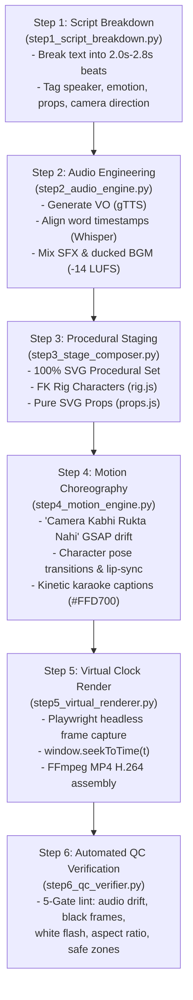

# 🎯 GrowKaz Video Production Harness (`HARNESS.md`)
### Automated Step-by-Step Pipeline & Agent Execution Guide

This document defines the **Automated Production Harness** for the **GrowKaz Stickman 2D Video Engine**.
If you are an AI Coding Agent (Antigravity, Claude Code, Cursor, Windsurf, Roo Code, Gemini CLI), **FOLLOW THIS SPECIFICATION EXACTLY** to create, animate, and render 100% accurate stickman videos from any script.

---

## ⚡ Quick Start: Single Command Video Generation

To generate a full video end-to-end:
```bash
# Generate video from a raw script or topic
python harness.py --script "Detective Gary investigates a dark medieval alley. A sneaky thief jumps from the shadows with a stolen gold coin! Gary points his magnifying glass and shocks the thief." --output my_first_video.mp4

# Run the automated verification test suite
python harness.py --test

# Run the pre-built reference demo pipeline
python harness.py --demo
```

---

## 🔄 The 6-Step Production Architecture



---

## 📋 Step-by-Step Agent Implementation Details

### Step 1: Script Breakdown (`step1_script_breakdown.py`)
- **Pacing Law**: Visual changes, camera focal nudges, or character pose transitions **MUST occur every 2.0 to 2.8 seconds**.
- **Beat Structure**:
  ```json
  {
    "id": "beat_01",
    "time_start": 0.0,
    "time_end": 2.5,
    "speaker": "narrator",
    "dialogue": "Midnight in the narrow stone alley.",
    "actor_action": "gary_walk_in",
    "camera_move": "drift_right_push_in",
    "environment": "medieval_alley",
    "props": ["streetlamp", "magnifier"]
  }
  ```

---

### Step 2: Audio Engineering (`step2_audio_engine.py`)
- **VO Synthesis**: Uses `gTTS` (or system TTS) to synthesize clear, character-distinct audio tracks.
- **Timestamp Alignment**: Runs `whisper.load_model("base")` with `word_timestamps=True` to get exact `start` and `end` millisecond bounds for every spoken word.
- **Audio Ducking**: Normalizes music bed to **-14 LUFS**, ducking BGM by **-18dB** whenever speech is active.
- **SFX Markers**: Inserts whooshes at camera whip transitions, impacts on reveals, and pop SFX on evidence arrivals.

---

### Step 3: Procedural Staging (`step3_stage_composer.py`)
- **Character Rig (`rig.js`)**:
  - Always uses Forward Kinematics (FK) angle rotation (`translate(joint) -> rotate(angle)`). **Never animate endpoint lines directly** (prevents detached limbs).
  - Select appropriate `headShape`:
    - `'square'` — Detective, stern, chiseled jaw.
    - `'pointed'` — Sly thief, cunning character.
    - `'oval'` — Scholarly, thin narrator.
    - `'chubby'` — Friendly guard, comical character.
    - `'round'` — Classic stickman.
  - Customize clothing (`jacket: 'trench'`, `tie: '#D32F2F'`, `hat: 'cap'`).
  - Welded neck collar + ground shadow under feet (`ellipse(rx=38, ry=10, fill='rgba(0,0,0,0.35)')`).
- **Procedural Backgrounds (`procedural-backgrounds`)**:
  - 100% SVG code. No external raster images!
  - Parallax structure:
    - `#layer-bg` (0.35x speed: distant brick walls, gothic windows, moon).
    - `#layer-mid` (0.65x speed: barrels, timber arches, lanterns).
    - `#layer-actors` (1.0x speed: stickmen, interacting props).

---

### Step 4: Motion Choreography (`step4_motion_engine.py`)
- **Core Creative Law: "Camera Kabhi Rukta Nahi"**:
  - The camera viewport **NEVER** stands still. An unbroken sub-current of motion runs from `t = 0.0` to the last frame.
  - Panning: Continuous linear or slow power-eased drift (`x: -60px, y: -20px`).
  - Punch-in Zooms: Causal scale jumps (`scale: 1.35 -> 1.72`) on shock moments or dialogue climaxes.
  - Creeping Zooms: During hold segments, use a continuous 1.02x creeping push to maintain viewer engagement.
- **Character Lip-Sync & Acting**:
  - Direct speech uses `hero.talk()` synchronized to whisper word timestamps.
  - Reactions: Shock jump, facepalm, weapon draw, or celebratory dance.
- **Kinetic Karaoke Subtitles**:
  - Centered at `bottom: 18%` (within 9:16 safe-zone bounds).
  - Active word highlighted in gold (`#FFD700`, scale 1.18).

---

### Step 5: Virtual Clock Renderer (`step5_virtual_renderer.py`)
- **Deterministic Virtual Clock**:
  - Do NOT screen-record live playback (live capture drops frames on heavy SVG).
  - Open HTML in headless Chromium via Playwright:
    ```javascript
    window.seekToTime(t); // Updates GSAP timeline and SVG state deterministically
    ```
  - Capture frame screenshot at 30 FPS (`t += 1/30`).
  - Stream directly to FFmpeg:
    ```bash
    ffmpeg -y -framerate 30 -f image2pipe -i - -i audio.mp3 -c:v libx264 -crf 18 -preset fast -pix_fmt yuv420p output.mp4
    ```

---

### Step 6: Automated QC Verification (`step6_qc_verifier.py`)
1. **Audio Sync Check**: Video duration matches master audio duration within ±0.05s.
2. **Zero White-Flash Check**: No frame exhibits sudden #FFFFFF opacity dips at transitions.
3. **Black Frame Detection**: Verifies no blank black frames occurred between scene handoffs.
4. **9:16 Safe-Zone Compliance**: Ensures titles and subtitles do not bleed into platform UI edges.

---

## 🛠️ CLI Reference

```bash
# Run the complete test suite
python -m harness.test_harness

# Generate a video with custom options
python -m harness.pipeline \
  --script "Detective Gary corners the thief at midnight" \
  --duration 20 \
  --output ./projects/my_video/final.mp4 \
  --style growkaz_mystery
```

